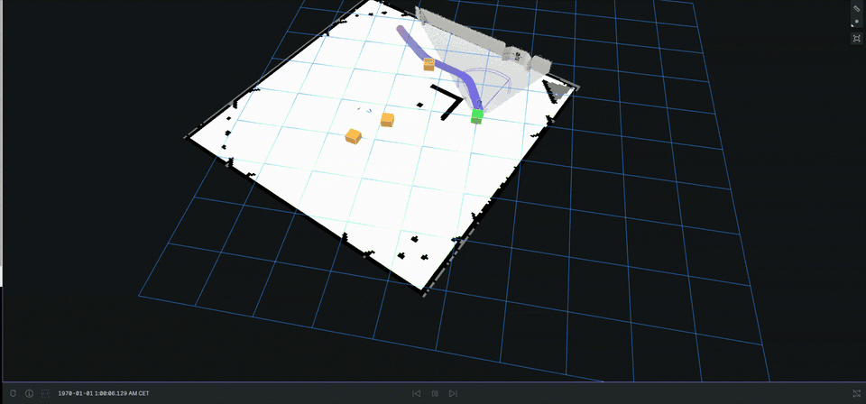

# Autonomy Stack

This repository contains ROS 2 software for an autonomous mobile-robot project.
It combines mapping and localization, mission planning,
camera/lidar perception, Nav2 control, docking, collision-safe escape behavior,
shared ROS interfaces, and a multi-robot evaluation harness.

## Demo

<p align="center">
  
</p>

<p align="center"><em>
Prediction-aware avoidance in simulation: the robot predicts the other robot's
motion, updates its global path, and follows the safer route around it.
</em></p>

The export is intentionally source-only. It contains no robot-vendor source,
mission-server source, credentials, trained models, maps, ROS bags, experiment
recordings, build products, or internal development logs.

## Packages

| Package | Purpose |
|---|---|
| [`interfaces`](interfaces/README.md) | Shared messages for missions, docks, predictions, health, trajectories, and coordination |
| [`slam`](slam/README.md) | `slam_toolbox`/AMCL integration, dock-tag mapping, snapshots, and wheel/IMU odometry |
| [`planning`](planning/README.md) | Mission adapter, dock occupancy, autonomous exploration, and camera coverage |
| [`control`](control/README.md) | Nav2 coordinator, docking adapter, collision-safe escape, and hardware command handling |
| [`control_docking`](control_docking/README.md) | Open Navigation docking plugin for tag-relative non-charging docks |
| [`control_mppi_critic`](control_mppi_critic/README.md) | Prediction-aware MPPI critic plugin |
| [`perception`](perception/README.md) | Detector adapters, multi-cue ranging, tracking, prediction, and dock-state inference |
| [`sim`](sim/README.md) | Multi-robot simulation and evaluation code; requires an external robot simulation package |

## Supported environment

- Ubuntu 24.04
- ROS 2 Jazzy
- Nav2 Jazzy
- Gazebo Harmonic
- Python 3.12

The core packages use standard ROS 2 and Nav2 interfaces. The simulation and
hardware launch profile are integration adapters: users must provide their own
robot description, Gazebo bringup, sensor drivers, mission service, and model
files. Those dependencies are deliberately not included here.

## Build

```bash
mkdir -p ~/autonomy_ws/src
cd ~/autonomy_ws/src
git clone YOUR_GITHUB_URL einride-stack
cd einride-stack
./tools/fetch_dependencies.sh

cd ~/autonomy_ws
source /opt/ros/jazzy/setup.bash
export PYTHONNOUSERSITE=1
rosdep install --from-paths \
  src/einride-stack/interfaces \
  src/einride-stack/slam \
  src/einride-stack/planning \
  src/einride-stack/control \
  src/einride-stack/control_docking \
  src/einride-stack/control_mppi_critic \
  src/einride-stack/perception \
  src/einride-stack/vendor_src/m-explore-ros2/explore \
  src/einride-stack/vendor_src/m-explore-ros2/explore_lite_msgs \
  --ignore-src -r -y
colcon build --symlink-install \
  --base-paths src/einride-stack \
  --packages-up-to interfaces slam planning control \
    control_docking control_mppi_critic perception explore_lite
```

The `sim` package is skipped in the public core build because its robot model and
bringup packages are external. Build it after supplying equivalent integration
packages and adapting its launch and model references to your platform.

## Tests

```bash
source /opt/ros/jazzy/setup.bash
export PYTHONNOUSERSITE=1
source ~/autonomy_ws/install/setup.bash
colcon test --packages-select interfaces slam planning control \
  control_docking control_mppi_critic perception
colcon test-result --verbose
```

`PYTHONNOUSERSITE=1` prevents unrelated packages installed under `~/.local`
from overriding the Python libraries supplied with ROS 2 and Ubuntu.

## Integration boundary

The autonomy packages consume standard ROS lidar, RGB/depth image, camera-info,
joint-state, IMU, odometry, occupancy-grid, TF, and Nav2 interfaces. The optional
simulation adapter requires a separately supplied robot description and simulator
bringup. Its package manifest, world launch, model resolver, and truth entity names
must be adapted to a different robot.

The mission service remains behind a small HTTP adapter. Supply a compatible
external service with `--mission-source` or `AUTONOMY_MISSION_SOURCE`, or replace the
adapter with manual goals. Hardware parameters are examples and must be measured
on the target platform. The collision monitor must remain the final publisher to
the physical velocity command topic.

## Configuration and credentials

All physical values are ROS parameters with units and comments in `config/`.
Credentials are accepted only through runtime environment variables. Do not put
tokens, passwords, model files, maps, snapshots, or recordings in this repository.
Run `./tools/publication_audit.sh` before publishing or deploying.

## License

Project source in this export is licensed under Apache License 2.0. External
dependencies retain their own licenses and are fetched separately.
